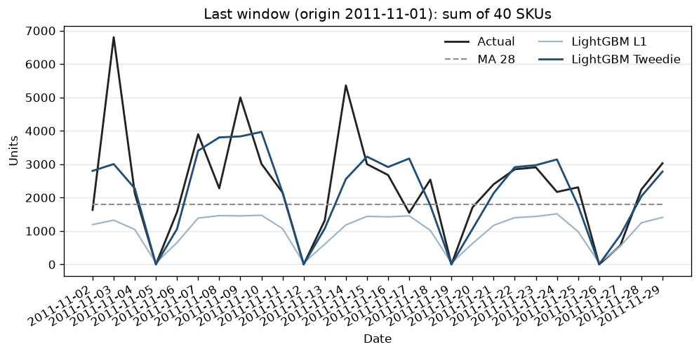
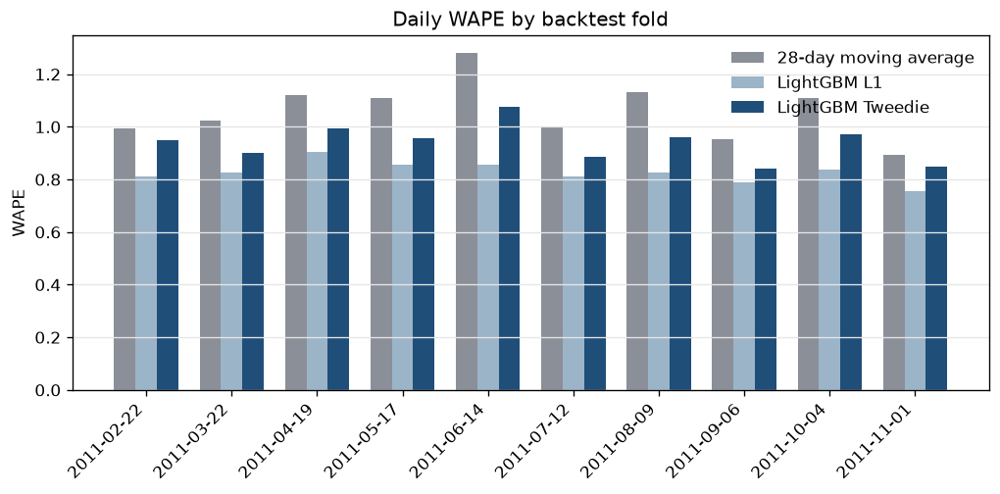
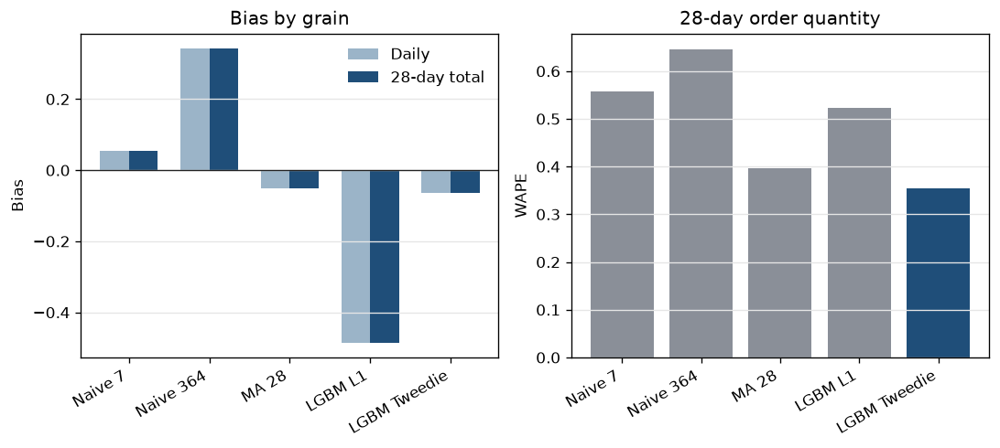

# Retail demand forecasting with SQL features

28-day SKU demand forecasts for a UK online gift retailer. DuckDB builds the model features in SQL. The decision compared here is the 28-day order quantity for one SKU at one origin, with bias reported beside WAPE.

**Headline.** At the 28-day order quantity (400 SKU-origins across 10 origins), the LightGBM Tweedie has the lowest WAPE, 0.355129, with bias -0.063205.

LightGBM Tweedie order-quantity WAPE was 0.355129 (bias -0.063205): 10.32% lower than the 28-day moving average (WAPE 0.395996). LightGBM L1, fit on absolute error, had order-quantity WAPE 0.522505 (bias -0.485450).

Those two sentences are the first two lines of `reports/headline.txt`. The same file records the daily aggregate, the daily shape score, the weekly track, and MAE, RMSE, and sMAPE. A longer cut of the same tables is in `reports/analysis.md`.

On individual SKU-days the lowest WAPE is LightGBM L1 (0.824654), and the lowest sMAPE is the weekly seasonal naive (0.964985). Those are different questions from the order quantity. Total bias, (sum of forecast minus actual) / sum of actual, is the same number at the daily grain and the 28-day grain because it uses the grand total. WAPE is not, because absolute error does not pass through a sum.

## Why this matters

A buyer setting a four-week replenishment order needs a unit total for each core SKU. Too high, and cash sits in stock. Too low, and the order is missed. WAPE divides absolute error by actual units, so a miss on a high-volume day counts more than a miss on a quiet day. The order-quantity WAPE applies that ratio to the 28-day sum. Bias shows whether the total sits high or low.

## Data

[UCI Online Retail II](https://archive.ics.uci.edu/dataset/502/online+retail+ii), donated by Daqing Chen. Invoices from a UK online retailer, 1 December 2009 to 9 December 2011. No account is required. `make download` fetches the zip, checks SHA-256 `572e36277c2390fbfde10664750731e0a86f55e33470d91919085f0408e67bfb`, and writes `data/raw/online_retail_ii.parquet`. That file is gitignored.

This run kept 1,044,848 invoice rows after dropping the duplicated 1–9 December 2010 overlap between the two yearly sheets. Cleaning left 931,357 UK product lines from 935,027 sales lines. Rules:

- United Kingdom only.
- Stock codes that start with a digit. Postage, bank charges, adjustments, and gift vouchers are excluded.
- Price must be positive. A return cancels one matching sale: same customer, same SKU, same quantity, within 21 days. Each return keeps its closest sale, and a sale keeps at most one return. The match is greedy, so it is not a minimum-cost assignment. Anonymous returns stay unmatched. This run matched 3,670 of 15,112 return lines. `sql/03_quality.sql` checks that matched sales equal matched returns, that clean quantity equals the daily unit total (8,950,843), and that the panel has no duplicate keys.
- SKU rank uses dates strictly before the first origin, 2011-02-22. That cutoff is `min(sale date) + 364 + 56 + 28`, the same expression as the backtest schedule. Among 430 SKUs with at least 180 sale days in that window, the top 40 by units. They account for 936,678 of 5,215,129 units before the cutoff (17.96%). Over the full cleaned history their unit share is 16.49% (1,475,728 of 8,950,843); that full-period share is descriptive and was not the ranking input.
- One row per selected SKU per day from 2009-12-01 to 2011-12-09. Days with no sale are zero units.

Examples, ranked on pre-cutoff units: 85123A white hanging heart T-light holder (60,447 units, 360 sale days), 84077 world war 2 gliders (56,976 units, 263 sale days), 21212 pack of 72 retrospot cake cases (51,436 units, 348 sale days). The full list is in `reports/build_stats.json`.

## Architecture

```
download script
  -> data/raw/online_retail_ii.parquet
  -> DuckDB raw_invoices
  -> sql/01_clean.sql
       1:1 cancellation match, daily sales, pre-origin SKU rank, daily panel
  -> sql/02_features.sql
       as-of lags, rolling mean/std, trailing price, direct 1..28 day rows
  -> sql/03_quality.sql
       QUALIFY checks for duplicate keys and broken matches, reconciliation counts
  -> sql/04_weekly.sql
       ISO-week panel, horizon 4, 1-week and 52-week naive
  -> baselines, Croston/SBA/TSB, LightGBM L1, LightGBM Tweedie
  -> rolling-origin backtest
  -> reports/
```

Each supervised row predicts a target date from an origin `horizon` days earlier. Lags, rolling means, and rolling standard deviations are SQL window functions that close on that origin. The weekly seasonal naive (season 7) and the same weekday last year (364 days, so the weekday lines up) are joins to dates on or before the origin. Target-day calendar fields, including days until Christmas, are known when the forecast is made. The price feature is the last realized unit price as of the origin divided by its trailing 28-day mean.

Two LightGBM models are refit at every origin on the same features: one global model, all 40 SKUs, horizons 1–28 together, SKU id categorical. The L1 model uses `regression_l1` and early-stops on L1. The Tweedie model uses variance power 1.5 (the usual compound Poisson-gamma setting) and early-stops on RMSE, so the stopping rule follows the mean. Shared settings: learning rate 0.05, 63 leaves, minimum 40 rows per leaf, feature fraction 0.9, bagging fraction 0.8, L2 1.0, at most 400 rounds, early stopping after 40 rounds on the 28 days before the origin, seed 42. Predictions are clipped at zero. These settings are in `src/demandforecast/config.py` and were not searched on the backtest.

The first origin is 2011-02-22. By then the training cut already contains 56 daily as-of dates with the 364-day lag defined, and the 28-day horizon still falls inside the sample. Later origins step forward 28 days through 2011-11-01 (10 folds, 11,200 SKU-days). The backtest checks that this first origin equals the SQL selection cutoff.

On this run the backtest stage, including the weekly track, took 43.2 seconds. For the Tweedie model, mean gain was highest for target day of week, then SKU id, days to Christmas, target day, and the 28-day rolling mean (`reports/feature_importance.csv`).

The weekly track aggregates the same panel to ISO weeks (Monday start; the first week begins 2009-11-30 and is partial). Horizon 4, step 4 weeks, with a 1-week naive (repeat the origin week), a 52-week naive (target week minus 364 days), a 4-week moving average, and one Tweedie model. Origins run from 2011-02-21 to 2011-10-31.

Croston, SBA, and TSB use a fixed smoothing constant of 0.1 and a flat forecast over the horizon. They are scored only on SKU-origins classed as lumpy from history through the origin, starting at the first positive day. The class uses the Syntetos-Boylan cutoffs ADI > 1.32 and CV² > 0.49. They are left out of the all-SKU WAPE.

## Reproduce

```bash
python -m venv .venv
source .venv/bin/activate
pip install -r requirements.txt
make test
make all
```

`make all` downloads, builds the feature tables, and writes `reports/`. A cached parquet is reused. `python -m demandforecast download --force` fetches the file again.

Commands: `make download`, `make build-features`, `make backtest`, `make test`.

Continuous integration runs the unit tests, including SQL feature values, the one-to-one cancellation cases, the pre-origin rank, and the as-of rule on a toy table. It does not download the UCI file. When `reports/predictions.csv` has the current model columns, the tests recompute daily metrics, order-quantity metrics, and the inventory summary from those predictions.

## Results

WAPE = sum(|forecast − actual|) / sum(|actual|). Bias = sum(forecast − actual) / sum(actual). sMAPE is the mean of 2|forecast − actual| / (|actual| + |forecast|), with 0/0 counted as 0. Rates below are ratios, not percentages. The display rounds rates to 6 decimal places and MAE/RMSE to 4; the CSVs have full precision.

Order quantity (sum of the 28-day horizon, one row per SKU-origin):

| model | SKU-origins | WAPE | bias |
| --- | --- | --- | --- |
| weekly seasonal naive | 400 | 0.557692 | +0.054680 |
| yearly seasonal naive | 400 | 0.646218 | +0.342904 |
| 28-day moving average | 400 | 0.395996 | -0.050239 |
| LightGBM L1 | 400 | 0.522505 | -0.485450 |
| LightGBM Tweedie | 400 | 0.355129 | -0.063205 |

Summing the 40 SKUs before scoring, daily aggregate WAPE was 0.393766 for Tweedie, 0.537963 for L1, 0.588800 for the 28-day moving average, 0.568517 for the weekly seasonal naive, and 0.725395 for the yearly seasonal naive.

Pooled daily SKU-days:

| model | points | MAE | RMSE | WAPE | sMAPE | bias |
| --- | --- | --- | --- | --- | --- | --- |
| weekly seasonal naive | 11200 | 58.4178 | 193.7641 | 1.276659 | 0.964985 | +0.054680 |
| yearly seasonal naive | 11200 | 66.7329 | 228.8161 | 1.458377 | 1.002279 | +0.342904 |
| 28-day moving average | 11200 | 48.1835 | 128.8235 | 1.053000 | 1.141511 | -0.050239 |
| LightGBM L1 | 11200 | 37.7347 | 129.6483 | 0.824654 | 1.177392 | -0.485450 |
| LightGBM Tweedie | 11200 | 42.6956 | 125.0627 | 0.933069 | 1.190162 | -0.063205 |

Pooled daily RMSE was lowest for Tweedie (125.0627). Pooled daily sMAPE was lowest for the weekly seasonal naive (0.964985). The per-fold table is in `reports/metrics.md`.

On the weekly track the lowest 4-week-total WAPE is Tweedie at 0.399551 (bias -0.003710), against 0.422572 for the 4-week moving average (bias -0.042427). Detail is in `reports/weekly_decision_metrics.csv`.

Of 400 SKU-origins, 276 were lumpy and 124 erratic under the origin-time rule above. None were smooth or intermittent. On the 7,728 lumpy SKU-days, WAPE was 1.113449 for SBA, 1.124895 for TSB, 1.137167 for Croston, 1.134960 for the 28-day moving average, 1.002714 for Tweedie, and 0.882282 for L1. L1's lumpy bias was -0.548452. At the lumpy order quantity, Tweedie WAPE was 0.396540 and the moving average was 0.451879.

Equal-count volume quartiles are computed from backtest actuals and are not features. Tweedie order-quantity WAPE was 0.287469 in Q2 and 0.324310 in Q3. In Q4 (253,602 units) it was 0.353343, next to 0.353140 for the moving average. In Q1 it was 0.561226 with bias +0.332390, above the moving average (0.553820) and L1 (0.433232).

Inventory cost uses one stated rule. Holding cost per unit equals the origin unit price, a retail-value proxy in sterling. Stockout cost per unit is 3 times holding cost. No SKU-origin was missing a price. Across 400 SKU-origins and 512,493 actual units, Tweedie cost was 539,989.86 (107,196.78 units short, 74,804.45 units over), the moving average cost was 622,921.20, and L1 cost was 1,124,125.06. The L1 row is the absolute-error contrast: it places few units over and many units short. The SKU-origin table is `reports/inventory_by_sku_origin.csv`.

The chart sums units across the 40 SKUs in the last window. The tables score each SKU-day or each SKU-origin.







## Limitations

- Recorded sales are not demand. Stockouts are not flagged, so some zeros are censored.
- The cancellation match is greedy. A return can be left unmatched when another return took its sale. 11,442 return lines in this extract have no match.
- 33 of the 40 SKUs already sell on 2009-12-01. The other seven start later, and the daily spine still fills the earlier days with zeros. Demand class and the Croston-family baselines start at the first positive day, so those leading zeros are not treated as gaps.
- There is no promotion calendar. Daily WAPE above 1 on the naive forecasts comes from bulk order days: a weekly copy often places that spike on the wrong date, and absolute error then exceeds volume.
- The long tail, and any SKU with fewer than 180 sale days before the first origin, is out of scope. The extract ends on 9 December 2011. On this 28-day grid the last scored day is 29 November 2011, before the final Christmas week.
- Two years is a short sample for a yearly lag. The model is a single fixed configuration. Tweedie power 1.5, Croston alpha 0.1, and the 3:1 stockout ratio were set before the backtest.
- The first and last ISO weeks are shorter than seven days.
- sMAPE, which treats a quiet day like a busy one, is lowest for the weekly seasonal naive on this sample.
- The order-quantity win for Tweedie is uneven. Q4 is effectively tied with the moving average, and Q1 is a loss, with Tweedie biased high on the smallest SKUs.
- Volume quartiles describe the backtest window. They are not inputs to the model.

## Next steps

- Estimate a stockout-to-holding ratio from margin and lead time when those figures exist, and add a prediction interval so the point forecast can feed a safety-stock rule.
- Reconcile SKU forecasts to a category total.
- Use a forward price and promo calendar when one exists.
- A separate path for SKUs that do not yet have 180 sale days before the cutoff.

## Author

Suleman Qamar, Sydney.

## License

MIT. The UCI extract is downloaded at runtime and is not in this repository.
