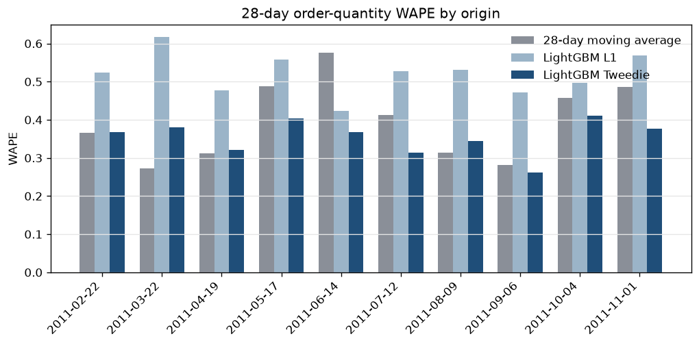

# Retail demand forecasting with SQL features

28-day demand forecasts for core SKUs of a UK online retailer, with DuckDB SQL features and a rolling-origin backtest.

LightGBM Tweedie order-quantity WAPE is 0.355 (bias -0.063), 10.32% lower than the 28-day moving average (WAPE 0.396), on 400 SKU-origins across 10 origins. An origin-cluster 95% interval for the WAPE gap (Tweedie minus the moving average) is [-0.090, +0.009] and includes zero. Tweedie is lower on 6 of 10 origins. SKU 22197 at origin 2011-06-14 is 20.75% of the net absolute-error reduction (actual 1626, Tweedie 1828.21, moving average 6175.00).



## Run

```bash
python -m venv .venv
source .venv/bin/activate
pip install -r requirements.txt
make test
make all
```

`make all` downloads the extract, builds the feature tables, and writes `reports/`. A cached parquet is reused. `python -m demandforecast download --force` fetches it again. Other targets: `make download`, `make build-features`, `make backtest`, `make test`.

Continuous integration runs the unit tests. It does not download the UCI file.

## Recorded result

Rates in the prose above are rounded to three decimal places. Tables and `reports/` keep the recorded precision. Full-precision lead sentence from `reports/headline.txt`:

At the 28-day order quantity (400 SKU-origins across 10 origins), LightGBM Tweedie WAPE was 0.355129 (bias -0.063205), 10.32% lower than the 28-day moving average (WAPE 0.395996); an origin-cluster 95% interval for the WAPE gap (Tweedie minus the moving average) is [-0.090274, +0.009449] and includes zero; Tweedie was lower on 6 of 10 origins.

The interval resamples the 10 origins (10,000 draws, seed 42) and scores WAPE on the summed order-quantity absolute error. See `reports/origin_cluster_interval.csv` and `reports/analysis.md`.

## Where the gap changes

In Q1, the lowest backtest-volume quartile (descriptive, 49,108 units, mean order 491.08), order-quantity WAPE is 0.561 for Tweedie (bias +0.332), 0.554 for the moving average (bias +0.025), and 0.433 for L1 (bias -0.273). Tweedie is above the 28-day actual on 77 of 100 SKU-origins, against 42 of 100 for the moving average.

SKU 84270 (ASSTD DESIGN BUBBLE GUM RING) has actual 0 on all 10 scored origins. Its last positive day is 2010-12-06, and it sold 20,866 units before the first origin. The moving average forecasts 0.00 units in total; Tweedie forecasts 1,240.10. Its share of the net absolute-error reduction is -5.92%.

Dropping SKU-origins with no sale in the 90 days before the origin (dates after origin minus 90 days, through the origin), without refitting, leaves 391 of 400 SKU-origins. On that slice, Tweedie WAPE is 0.353 (bias -0.065) and the moving average is 0.396, 10.80% lower for Tweedie. The nine dropped rows are all 84270. The 2011-02-22 origin stays in, because that window still contains the last sale (47 units on 2010-12-06). The moving-average WAPE is unchanged: those dropped origins have actual 0 and a moving-average forecast of 0.

Horizon cuts are partial sums of the fitted 28-day forecasts. Days 1-7: Tweedie WAPE 0.571 is 0.70% higher than the moving average (0.567). Days 1-14: Tweedie WAPE 0.438 is 5.23% lower than the moving average (0.462).

| days | Tweedie WAPE | moving-average WAPE | what it is |
| --- | --- | --- | --- |
| 1-7 | 0.571241 | 0.567251 | partial sum, not a refit |
| 8-14 | 0.544067 | 0.583832 | partial sum, not a refit |
| 15-21 | 0.521451 | 0.570639 | partial sum, not a refit |
| 22-28 | 0.565939 | 0.591624 | partial sum, not a refit |
| 1-14 | 0.437721 | 0.461885 | partial sum, not a refit |
| 1-28 | 0.355129 | 0.395996 | partial sum, not a refit |

A separate LightGBM fit trains only on the 20 SKUs with the most units before the first origin. On that refit, order-quantity WAPE is 0.373 for Tweedie (bias -0.104) and 0.396 for the moving average (5.79% lower for Tweedie), across 200 SKU-origins. The same 20 SKUs scored from the top-40 model, without another training run, are 0.357 and 0.396 (9.92% lower for Tweedie). The refit list includes 84270. Files: `reports/top20_pre_cutoff_skus.csv`, `reports/top20_refit_predictions.csv`, `reports/top20_slice_decision_metrics.csv`.

## Data

[UCI Online Retail II](https://archive.ics.uci.edu/dataset/502/online+retail+ii), donated by Daqing Chen. UK online retailer invoices, 1 December 2009 to 9 December 2011. `make download` checks SHA-256 `572e36277c2390fbfde10664750731e0a86f55e33470d91919085f0408e67bfb` and writes `data/raw/online_retail_ii.parquet` (gitignored).

This run kept 1,044,848 invoice rows after dropping the duplicated 1-9 December 2010 overlap. Cleaning left 931,357 UK product lines from 935,027 sales lines.

- United Kingdom only. Stock codes that start with a digit. Price must be positive.
- A return cancels one matching sale: same customer, same SKU, same quantity, within 21 days. Each return keeps its closest sale, and a sale keeps at most one return. The match is greedy. Anonymous returns stay unmatched. This run matched 3,670 of 15,112 return lines. `sql/03_quality.sql` checks that matched sales equal matched returns, that clean quantity equals the daily unit total (8,950,843), and that the panel has no duplicate keys.
- SKU rank uses dates strictly before the first origin, 2011-02-22. That cutoff is `min(sale date) + 364 + 56 + 28`, the same expression as the backtest schedule. Among 430 SKUs with at least 180 sale days in that window, the top 40 by units. They account for 936,678 of 5,215,129 units before the cutoff (17.96%). Their share of the full cleaned history is 16.49% (1,475,728 of 8,950,843); that share was not the ranking input.
- One row per selected SKU per day from 2009-12-01 to 2011-12-09. Days with no sale are zero units.

Examples, ranked on pre-cutoff units: 85123A white hanging heart T-light holder (60,447 units, 360 sale days), 84077 world war 2 gliders (56,976 units, 263 sale days), 21212 pack of 72 retrospot cake cases (51,436 units, 348 sale days). The list is in `reports/build_stats.json`.

## Method

```
download script
  -> data/raw/online_retail_ii.parquet
  -> DuckDB raw_invoices
  -> sql/01_clean.sql
  -> sql/02_features.sql
  -> sql/03_quality.sql
  -> sql/04_weekly.sql
  -> baselines, Croston/SBA/TSB, LightGBM L1, LightGBM Tweedie
  -> rolling-origin backtest
  -> reports/
```

Each supervised row predicts a target date from an origin `horizon` days earlier. Lags and rolling statistics are SQL window functions that close on that origin. The weekly seasonal naive (season 7) and the same weekday last year (364 days) join to dates on or before the origin. Target-day calendar fields, including days until Christmas, are known when the forecast is made. The price feature is the last realized unit price as of the origin, divided by its trailing 28-day mean.

Two LightGBM models are fit at every origin on the same features: one global model, all 40 SKUs, horizons 1-28 together, SKU id categorical. The L1 model uses `regression_l1` and early-stops on L1. The Tweedie model uses variance power 1.5 and early-stops on RMSE. Predictions are clipped at zero.

Learning rate 0.05, 63 leaves, minimum 40 rows per leaf, feature fraction 0.9, bagging fraction 0.8, L2 1.0, at most 400 rounds, early stopping of 40 rounds, and seed 42 were fixed before any score. Tweedie variance power 1.5 is the library default and was not searched. The Tweedie objective was chosen after an earlier absolute-error LightGBM on these same origin dates under-forecast the total (bias -0.535). That earlier run ranked its 40 SKUs on the full cleaned history, so its assortment is different from the pre-cutoff list used here. Settings live in `src/demandforecast/config.py`.

The first origin is 2011-02-22. Later origins step forward 28 days through 2011-11-01 (10 folds, 11,200 SKU-days). The last scored day is 2011-11-29. The backtest checks that the first origin equals the SQL selection cutoff.

On this run the backtest stage, including the weekly track and the top-20 refit, took 66.9 seconds. For the Tweedie model, mean gain was highest for target day of week, then SKU id, days to Christmas, target day, and the 28-day rolling mean (`reports/feature_importance.csv`).

The weekly track aggregates the same panel to ISO weeks (Monday start; the first week begins 2009-11-30 and is partial). Horizon 4, step 4 weeks, origins 2011-02-21 to 2011-10-31. It uses the same SKUs and an overlapping calendar.

Croston, SBA, and TSB use smoothing constant 0.1 and a flat forecast over the horizon. They are scored only on SKU-origins classed as lumpy from history through the origin, starting at the first positive day (ADI > 1.32 and CV² > 0.49). They are left out of the all-SKU WAPE. Of 400 SKU-origins, 276 were lumpy and 124 erratic. None were smooth or intermittent.

## Results

WAPE = sum(|forecast - actual|) / sum(|actual|). Bias = sum(forecast - actual) / sum(actual). sMAPE is the mean of 2|forecast - actual| / (|actual| + |forecast|), with 0/0 counted as 0. Rates below are ratios. The display rounds rates to 6 decimal places and MAE/RMSE to 4; the CSVs have full precision.

Order quantity (sum of the 28-day horizon, one row per SKU-origin):

| model | SKU-origins | WAPE | bias |
| --- | --- | --- | --- |
| weekly seasonal naive | 400 | 0.557692 | +0.054680 |
| yearly seasonal naive | 400 | 0.646218 | +0.342904 |
| 28-day moving average | 400 | 0.395996 | -0.050239 |
| LightGBM L1 | 400 | 0.522505 | -0.485450 |
| LightGBM Tweedie | 400 | 0.355129 | -0.063205 |

LightGBM L1, fit on absolute error, has order-quantity WAPE 0.523 (bias -0.485). Summing the 40 SKUs before scoring, daily aggregate WAPE is 0.394 for Tweedie, 0.538 for L1, 0.589 for the 28-day moving average, 0.569 for the weekly seasonal naive, and 0.725 for the yearly seasonal naive.

Pooled daily SKU-days. On this grain the lowest WAPE is L1 (0.825) and the lowest sMAPE is the weekly seasonal naive (0.965). Total bias matches the order-quantity bias because both use the grand total. WAPE does not, because absolute error does not pass through a sum.

| model | points | MAE | RMSE | WAPE | sMAPE | bias |
| --- | --- | --- | --- | --- | --- | --- |
| weekly seasonal naive | 11200 | 58.4178 | 193.7641 | 1.276659 | 0.964985 | +0.054680 |
| yearly seasonal naive | 11200 | 66.7329 | 228.8161 | 1.458377 | 1.002279 | +0.342904 |
| 28-day moving average | 11200 | 48.1835 | 128.8235 | 1.053000 | 1.141511 | -0.050239 |
| LightGBM L1 | 11200 | 37.7347 | 129.6483 | 0.824654 | 1.177392 | -0.485450 |
| LightGBM Tweedie | 11200 | 42.6956 | 125.0627 | 0.933069 | 1.190162 | -0.063205 |

Pooled daily RMSE is lowest for Tweedie (125.0627). The per-fold table is in `reports/metrics.md`.

On the weekly track the lowest 4-week-total WAPE is Tweedie at 0.400 (bias -0.004), against 0.423 for the 4-week moving average (bias -0.042). Detail is in `reports/weekly_decision_metrics.csv`.

Equal-count volume quartiles are computed from backtest actuals and are not features. In Q4 (253,602 units) Tweedie order-quantity WAPE is 0.353, the same three-decimal figure as the moving average (exact values 0.353343 and 0.353140). Segment rows are in `reports/analysis.md`.

Inventory cost uses one stated rule. Holding cost per unit equals the origin unit price. Stockout cost per unit is 3 times holding cost. No SKU-origin was missing a price. Across 400 SKU-origins and 512,493 actual units, Tweedie cost was 539,989.86 (107,196.78 units short, 74,804.45 units over), the moving average cost was 622,921.20, and L1 cost was 1,124,125.06. The SKU-origin table is `reports/inventory_by_sku_origin.csv`.


## Limitations

- Recorded sales are not demand. Stockouts are not flagged, so some zeros are censored.
- The cancellation match is greedy. 11,442 return lines in this extract have no match.
- 33 of the 40 SKUs already sell on 2009-12-01. The other seven start later. Demand class and the Croston-family baselines start at the first positive day.
- There is no promotion calendar. Daily WAPE above 1 on the naive forecasts comes from bulk order days placed on the wrong date.
- SKUs with fewer than 180 sale days before the first origin are out of scope. The extract ends on 9 December 2011. The last scored day on this grid is 29 November 2011.
- Two years is a short sample for a yearly lag. Tree settings, Tweedie power 1.5, Croston alpha 0.1, and the 3:1 stockout ratio were set before these scores. The Tweedie objective was chosen after the earlier L1 run. There is no later year left as a confirmation sample.
- The order-quantity gap has an origin-cluster interval that includes zero, and Tweedie wins 6 of 10 origins. Days 1-7 are a loss for Tweedie. Q1 is biased high. SKU 84270 still receives a positive Tweedie forecast. The top-20 refit narrows the gap relative to a slice of the top-40 model.
- The first and last ISO weeks are shorter than seven days.
- Volume quartiles describe the backtest window. The 90-day activity flag is an evaluation slice.

## Next steps

- Estimate a stockout-to-holding ratio from margin and lead time when those figures exist, and add a prediction interval for a safety-stock rule.
- Reconcile SKU forecasts to a category total.
- Use a forward price and promo calendar when one exists.
- A separate path for SKUs that do not yet have 180 sale days before the cutoff.

## Author

Suleman Qamar, Sydney.

## License

MIT. The UCI extract is downloaded at runtime and is not in this repository.
